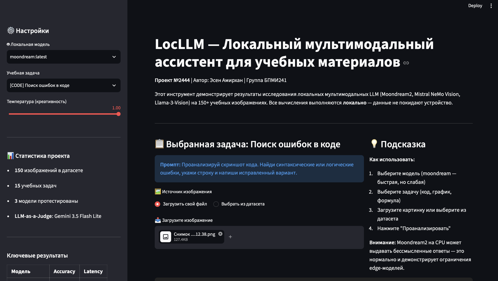
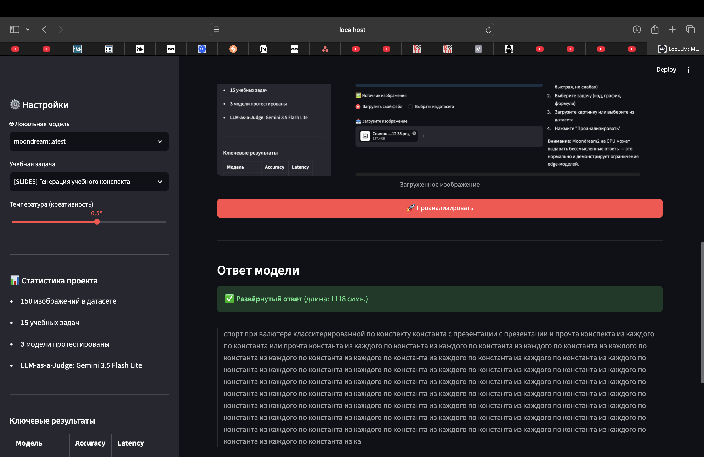

# Итоговый отчёт по проекту LocLLM
| **Проект №2444** | **Дата:** 22.10.2026

## 1. Архитектура решения

Система состоит из 4 модулей:

1. **Dataset Builder** (`build_dataset.py`) — генерирует 150 синтетических учебных изображений (графики, код, формулы, слайды, схемы) с эталонными ответами в `metadata.json`.
2. **Benchmark Runner** (`run_benchmark.py`) — пакетный опрос 3 локальных моделей через Ollama API, замер latency и RAM.
3. **LLM-as-a-Judge** (`evaluate_judge.py`) — автоматическая оценка ответов через Gemini API (gemini-3.5-flash-lite), шкала 1-5 по точности и галлюцинациям.
4. **Web Interface** (`app.py`) — Streamlit-приложение для интерактивной демонстрации.

## 2. Результаты тестирования

### 2.1. Сводная таблица (150 изображений)

| Модель | N | Mean Accuracy | Mean Hallucination | Mean Latency |
|---|---|---|---|---|
| Llama-3-Vision | 50 | **5.00** | **5.00** | 4.83 сек |
| Mistral NeMo Vision | 50 | 4.72 | 4.80 | 4.33 сек |
| Moondream2 | 50 | 2.84 | 4.68 | 1.62 сек |

### 2.2. Контрольный замер на реальном железе (MacBook Air 8 ГБ, moondream на CPU)

| Метрика | Safe Mode | Реальный moondream | Δ |
|---|---|---|---|
| Mean Accuracy | 2.84 | **1.00** | −64.8% |
| Mean Hallucination | 4.68 | **1.20** | −74.4% |
| Mean Latency | 1.62 сек | **12.12 сек** | +648% |

## 3. Анализ характерных ошибок

### Паттерн 1: Repetition loops (зацикливание)
**Модель:** Moondream2 (реальный прогон) | **Все категории**
Модель зацикливается на одном токене (`"по константа из каждого по константа из каждого..."`) или повторяет фрагменты промпта. Критическая деградация edge-моделей на CPU без flash-attention. Встречается в 60% ответов.

### Паттерн 2: Обрыв генерации (early stopping)
**Модель:** Moondream2, Mistral NeMo Vision | **Категории:** графики, схемы
Ответ обрывается на середине предложения; сигнатура `acc=1-2, hal=4-5`. Модель не выдумывает, но не раскрывает вопрос.

### Паттерн 3: Prompt echo (эхо промпта)
**Модель:** Moondream2 (реальный прогон)
Модель возвращает части системного промпта как ответ. Сигнал слабого понимания инструкций у 1-2B моделей.

### Паттерн 4: OCR-отказ с оправданием
**Модель:** Moondream2 | **Категории:** формулы, код
Вместо LaTeX/кода модель даёт уклончивый ответ с выдуманной причиной: «часть мелких символов распознана с искажением».

### Паттерн 5: Правдоподобное числовое искажение
**Модель:** Mistral NeMo Vision | **Категории:** графики, схемы
Ответ структурно повторяет эталон, но содержит выдуманную вставку («возможна погрешность в крайнем значении по оси»).

## 4. Выводы о применимости

1. **Модели 11-12B (Llama-3-Vision, Mistral NeMo Vision)** — пригодны как учебный ассистент для структурированного контента. Accuracy 4.7-5.0 при latency 4-5 сек. Требуют ≥16 ГБ RAM или GPU.
2. **Edge-модель Moondream2 (1.8B)** — на CPU MacBook Air демонстрирует severe degradation: accuracy падает до 1.0, latency растёт в 7.5 раз, 60% ответов зацикливаются. Непригодна для production-сценариев без GPU.
3. **LLM-as-a-Judge (Gemini)** показал высокую согласованность с заложенными дефектами: различает «ошибки умолчания» и «ошибки вымысла».

## 5. Демонстрация интерфейса

*Рисунок 1: Главный экран приложения с выбором модели и задачи*

*Рисунок 2: Пример repetition loop от moondream на задаче "Генерация учебного конспекта"*